<p align="center"></p>

<p align="center">
  <a href="https://github.com/Sapientropic/H0mework/actions/workflows/ci.yml"></a>
  <a href="https://h0mework.wiki/en/"></a>
  <a href="#papers"></a>
  <a href="LICENSE"></a>
</p>

<p align="center"><a href="README.md">简体中文</a> · English</p>

Lean 4 proofs, reproduction programs and frozen evidence behind a family of research papers. The papers tell the story to people; this repository hands every sentence stated as a theorem to the machine and checks it again from scratch.

**You don't have to trust the authors. You can check.** To read the papers first, visit [h0mework.wiki](https://h0mework.wiki/en/).

## Machine-checked

<a href="https://github.com/Sapientropic/H0mework/actions/runs/39025063045"></a>

- **All 47,616 Lean modules pass the kernel.** 11 stages, 61 shards and 66 jobs went green in one run: [run 39025063045](https://github.com/Sapientropic/H0mework/actions/runs/39025063045) on commit `279d795d`, with `--trust=0` package-wide.
- **Every cited declaration is audited again per edition.** Across its full dependency closure, the only axioms are Lean's standard three (`propext`, `Classical.choice`, `Quot.sound`), with `unsafe = 0` and `partial = 0`. Receipts are in the [first-release](docs/first-release-readiness.md) and [second-edition](docs/second-edition-readiness.md) acceptance records.
- **Later runs check the content fingerprint.** While the Lean selection is unchanged, CI reuses this acceptance; that is what the green badge refers to.
- **The green took many runs.** The ten days before it saw 56 consecutive runs that did not pass: single modules peak at 58 GiB of memory and have to compile on 16 GiB hosted runners, and per-module compile times add up to more than 570 runner hours. Sharding, cross-run continuation and memory scheduling are described in [CI and incremental builds](docs/ci.md).

## Papers

| Paper | Zenodo | Proofs |
| --- | --- | --- |
| [**The State Is Not the History, the Source Is**](https://h0mework.wiki/en/papers/source-process-core/): Identity, Responsibility, and Minimal Revision in Processes | [v2](https://doi.org/10.5281/zenodo.23297175) | [Map](docs/second-edition-map.json) · [Reproduce](docs/edition-reproduction.md) |
| [**We Found No Magic in This Mighty Universe**](https://h0mework.wiki/en/papers/physics-common-source/): Common-Source Generation and Classical–Quantum Correspondence in a Spin×SU(7) Theory | [v2](https://doi.org/10.5281/zenodo.23297179) | [Map](docs/second-edition-map.json) · [Reproduce](docs/edition-reproduction.md) |
| [**The Current Takes the Stand**](https://h0mework.wiki/en/papers/low-energy-phenomenology/): From Coupled Propagation to Actual Electrons, Coulomb Response, and Born Dressing | [v1](https://doi.org/10.5281/zenodo.23299174) | [Map](docs/low-energy-release-map.json) · [Reproduce](docs/edition-reproduction.md) |
| [**Two Minuses, One Plus, and a Bare Trace Under Oath**](https://h0mework.wiki/en/papers/low-energy-loop-response/): Ordered Closed Traces and Whole-Ball Response Curvature | [v1](https://doi.org/10.5281/zenodo.23299177) | [Map](docs/low-energy-release-map.json) · [Reproduce](docs/edition-reproduction.md) |
| [**Book-Balancing Magic Has Nowhere to Hide**](https://h0mework.wiki/en/papers/whole-ledger-accounting/): Source-Native Accounting and Actual Continuation | [v1](https://doi.org/10.5281/zenodo.23437454) | [Map](docs/whole-ledger-map.json) · [Reproduce](docs/whole-ledger-reproduction.md) |
| [**1 Bit Is All You Need**](https://h0mework.wiki/en/papers/one-bit/): The Weakest Superpower: No Unaccounted Differences | [v1](https://doi.org/10.5281/zenodo.23437456) | [Map](docs/one-bit-map.json) · [Reproduce](docs/one-bit-reproduction.md) |

Main texts, proof supplements and editable sources are available from each Zenodo record; each map lists, claim by claim, the Lean declaration it rests on.

<details>
<summary>Earlier editions and source bindings</summary>

- The first versions of the process-core and physics papers retain their original DOIs ([process core](https://doi.org/10.5281/zenodo.23210084), [physics](https://doi.org/10.5281/zenodo.23210292)) and [first-release package](papers/first-release/README.md). The [2026-10-09 low-energy snapshot](papers/low-energy-first-release/2026-10-09/README.md) retains its original file and source identities.
- The second editions and the two low-energy papers cite source commit `b9d66048`. Later public-source repairs and their `643721f1` binding are described in the [source index](docs/source-materials.md#四篇论文的源码绑定); material acceptance is recorded in the [edition status](docs/second-edition-readiness.md).
- Whole-ledger accounting and One Bit cite [`4301fa8c`](https://github.com/Sapientropic/H0mework/tree/4301fa8c5bb19bb1e8c3824d7c69be406264ed12) and [`6bff9d40`](https://github.com/Sapientropic/H0mework/tree/6bff9d4046b3f89004678244482b1c403837150c); their accepted scopes are in the [whole-ledger](docs/whole-ledger-readiness.md) and [One Bit](docs/one-bit-readiness.md) acceptance records.
- The earlier eight papers are bound to the [`papers-2026-09`](https://github.com/Sapientropic/H0mework/tree/papers-2026-09) tag, with commands in the [original reproduction guide](docs/reproduction.md). The first two-paper release follows the fixed versions in the [claim-to-source map](docs/first-release-map.json).

</details>

## Check it yourself

From the repository root, with Git, make and Python 3 (with `venv`); building Lean also needs elan.

```bash
make check-first-release-entry                # Entry checks: export integrity, Fock/Born identities, exact controls
make bootstrap && make build-first-release    # Fetch the pinned dependency cache and build the Lean proofs
make check-first-release-full                 # Complete acceptance suite
```

The [reproduction guide](docs/first-release-reproduction.md) describes scope and dependencies; the [acceptance record](docs/first-release-readiness.md) links the actual results. The toolchain is pinned in [`lean-toolchain`](Lean/lean-toolchain) and [`lake-manifest.json`](Lean/lake-manifest.json).

## Research threads

| Thread | Subject | Lean entry |
| --- | --- | --- |
| Low-energy phenomenology | Low-energy expansions, propagation, matter exchange and all-time Kubo response | [LowEnergyPhenomenology](Lean/H0mework/Papers/LowEnergyPhenomenology.lean) |
| Low-energy loop response | Closed traces, complete words of prepared states, bosonic effective kernels and analytic remainders | [LowEnergyLoopResponse](Lean/H0mework/Papers/LowEnergyLoopResponse.lean) |
| Constrained local quantum theory | Constraints from the original action, quantum constraints and common-family time evolution | [ConstrainedLocalQuantumK17](Lean/H0mework/Papers/ConstrainedLocalQuantumK17.lean) |
| Native flow | Native Navier–Stokes evolution and consumers of its history | [NativeFlow](Lean/H0mework/Papers/NativeFlow.lean) |
| Whole-ledger accounting | Whole-ledger structures, debt settlement and unforgeable settlement | [WholeLedgerAccountingY1](Lean/H0mework/Papers/WholeLedgerAccountingY1.lean) |
| Observation dynamics | Counted observation, versioned proofs and the exact cost of compression | [ObservationDynamics](Lean/H0mework/Papers/ObservationDynamics.lean) |

## Repository map

| Directory | Contents |
| --- | --- |
| [`Lean/`](Lean) | Proofs |
| [`scripts/`](scripts) | Reproduction programs |
| [`evidence/`](evidence) | Frozen results and acceptance receipts |
| [`papers/`](papers) | Main texts, supplements and packages of published papers |
| [`site/`](site) | Source of [h0mework.wiki](https://h0mework.wiki/en/) |

- [Evidence map](docs/evidence-map.md): the module, program and receipt behind each paper claim, including independent checks of Bell data.
- [Source materials](docs/source-materials.md): mechanism descriptions, verification reports, research history and third-party sources.
- [`tools/export-map.json`](tools/export-map.json): origin and hash of every file.

## License

Original code and evidence are distributed under Apache-2.0; see [LICENSE](LICENSE) and [NOTICE](NOTICE). Each paper's license is the one on its Zenodo record; the first-release papers use CC BY 4.0, see their [publication metadata](papers/first-release/source/papers/source-process-core/zenodo-metadata.md#licenses). Third-party excerpts retain their original copyright and license; see the [third-party source index](docs/source-materials.md#第三方材料).
