<p align="center"></p>

<p align="center">
  <a href="https://github.com/Sapientropic/H0mework/actions/workflows/ci.yml"></a>
  <a href="https://h0mework.wiki"></a>
  <a href="#论文"></a>
  <a href="LICENSE"></a>
</p>

<p align="center">简体中文 · <a href="README.en.md">English</a></p>

一组论文背后的 Lean 证明、复现程序与冻结证据。论文把故事讲给人听；这里把每一句写成定理的话交给机器，从头再核一遍。

**读者不必相信作者，可以亲手检验。** 想先读论文，去 [h0mework.wiki](https://h0mework.wiki)。

## 机器已核

<!-- BEGIN CI STATUS -->
<a href="https://github.com/Sapientropic/H0mework/actions/runs/43159515852"></a>

- **62,694 个 Lean 模块通过完整内核验收。** [验收运行](https://github.com/Sapientropic/H0mework/actions/runs/43159515852) 使用 11 个阶段、106 个分片，全包 `--trust=0`，提交 `53c8d110`。当前构建覆盖 62,695 个模块、107 个分片。
<!-- END CI STATUS -->

- **论文引用的声明逐版再审。** 完整依赖闭包只使用 Lean 标准三条公理，`unsafe = 0`、`partial = 0`；各篇验收与复现入口列在下方论文分组中。
- **新增内容重新构建，不变内容复用验收。** 分片、跨运行续建与内存调度见 [CI 与增量构建](docs/ci.md)。

## 论文

<!-- BEGIN PAPERS -->
**[在网站上浏览全部论文，读摘要并逐条展开证明 →](https://h0mework.wiki/papers/)**

最新：[可能性的经济宪法](https://h0mework.wiki/papers/economic-constitution/) · [资本主义的结构总定理](https://h0mework.wiki/papers/capital-formation/)

<details>
<summary><strong>总序</strong> · 1 篇</summary>

- [现实刚性与单母源普遍形成](https://h0mework.wiki/papers/one-bit/) · [v2](https://doi.org/10.5281/zenodo.24135399) · [映射](docs/one-bit-v2-map.json) · [复现](docs/one-bit-v2-reproduction.md)

</details>

<details>
<summary><strong>核心方法</strong> · 2 篇</summary>

- [源生过程代数与初始余面修订](https://h0mework.wiki/papers/source-process-core/) · [v3](https://doi.org/10.5281/zenodo.24147130) · [映射](docs/source-process-core-v3-map.json) · [复现](docs/source-process-core-v3-reproduction.md)
- [溯源守恒演算与非免费连续性](https://h0mework.wiki/papers/whole-ledger-accounting/) · [v2](https://doi.org/10.5281/zenodo.24147183) · [映射](docs/whole-ledger-v2-map.json) · [复现](docs/whole-ledger-v2-reproduction.md)

</details>

<details>
<summary><strong>场论与动力学</strong> · 1 篇</summary>

- [从单一发生源到连续—量子统一场](https://h0mework.wiki/papers/physics-common-source/) · [v3](https://doi.org/10.5281/zenodo.24100339) · [映射](docs/physics-third-edition-map.json) · [复现](docs/physics-third-edition-reproduction.md)

</details>

<details>
<summary><strong>低能系列</strong> · 2 篇</summary>

- [电流出庭](https://h0mework.wiki/papers/low-energy-phenomenology/) · [v1](https://doi.org/10.5281/zenodo.23299174) · [映射](docs/low-energy-release-map.json) · [复现](docs/edition-reproduction.md)
- [两负一正，裸迹宣誓](https://h0mework.wiki/papers/low-energy-loop-response/) · [v1](https://doi.org/10.5281/zenodo.23299177) · [映射](docs/low-energy-release-map.json) · [复现](docs/edition-reproduction.md)

</details>

<details>
<summary><strong>社会与制度</strong> · 4 篇</summary>

- [典范社会总定理](https://h0mework.wiki/papers/generated-society/) · [v3](https://doi.org/10.5281/zenodo.24162923) · [映射](docs/generated-society-v3-map.json) · [复现](docs/generated-society-v3-reproduction.md)
- [可能性的经济宪法](https://h0mework.wiki/papers/economic-constitution/) · [v3](https://doi.org/10.5281/zenodo.24171243) · [映射](docs/economic-constitution-v3-map.json) · [复现](docs/economic-constitution-v3-reproduction.md)
- [资本主义的结构总定理](https://h0mework.wiki/papers/capital-formation/) · [v2](https://doi.org/10.5281/zenodo.24155195) · [映射](docs/capital-formation-v2-map.json) · [复现](docs/capital-formation-v2-reproduction.md)
- [战争与和平的源生终局定理](https://h0mework.wiki/papers/enforceable-peace/) · [v1](https://doi.org/10.5281/zenodo.24093231) · [映射](docs/enforceable-peace-map.json) · [复现](docs/enforceable-peace-reproduction.md)

</details>
<!-- END PAPERS -->

正文、证明补充与可编辑源码从各自 Zenodo 记录下载；网站可逐条展开主张、Lean 声明与原证据，映射和复现入口则归并到上面的主题分组。

<details>
<summary>旧版本与源码绑定</summary>

- 过程核心与物理旗舰的第一版保留原 DOI（[过程核心](https://doi.org/10.5281/zenodo.23210084)、[物理旗舰](https://doi.org/10.5281/zenodo.23210292)）及[首发成品](papers/first-release/README.md)；低能两稿的[2026-10-09 成品快照](papers/low-energy-first-release/2026-10-09/README.md)保留原文件与绑定身份。
- 过程核心／物理旗舰第二版及低能两稿固定引用公开源码 `b9d66048`；后续修复与 `643721f1` 的对应见[源码绑定](docs/source-materials.md#四篇论文的源码绑定)，材料验收见[版本状态](docs/second-edition-readiness.md)。
- 过程核心第三版与整账法第二版固定引用 [`5f94af7e`](https://github.com/Sapientropic/H0mework/tree/5f94af7e988c9831c92e54fe89747699fa29cd85)。[过程核心验收](docs/source-process-core-v3-readiness.md) · [整账法验收](docs/whole-ledger-v2-readiness.md) · [缓存保全](evidence/whole-ledger-v2/acceptance/cache-preservation.json)。一比特第二版固定引用 [`ffa5eeb7`](https://github.com/Sapientropic/H0mework/tree/ffa5eeb70130b17db3873407d0cd10a218e45896)，逐项验收见[复现指南](docs/one-bit-v2-reproduction.md)。
- 首版八稿的“代码与数据可用性”对应标签 [`papers-2026-09`](https://github.com/Sapientropic/H0mework/tree/papers-2026-09)，命令见[旧版复现指南](docs/reproduction.md)；首发修订选集按[逐主张映射](docs/first-release-map.json)使用各自固定来源。

</details>

## 亲手检验

在仓库根目录，需要 Git、make、Python 3（含 `venv`）；构建 Lean 另需 elan。

```bash
make check-first-release-entry                # 入口检查：导出身份、完整 Fock、Born 与精确控制
make bootstrap && make build-first-release    # 取回固定依赖缓存，构建 Lean 证明
make check-first-release-full                 # 完整验收
```

范围与依赖见[首发复现指南](docs/first-release-reproduction.md)，实际结果见[首发准备状态](docs/first-release-readiness.md)。工具链由 [`lean-toolchain`](Lean/lean-toolchain) 与 [`lake-manifest.json`](Lean/lake-manifest.json) 固定。

## 研究线

| 研究线 | 内容 | Lean 入口 |
| --- | --- | --- |
| 低能唯象 | 低能展开、传播、物质交换与全时间 Kubo 响应 | [LowEnergyPhenomenology](Lean/H0mework/Papers/LowEnergyPhenomenology.lean) |
| 低能环响应 | 闭迹、准备态完整词、玻色有效核与解析余项 | [LowEnergyLoopResponse](Lean/H0mework/Papers/LowEnergyLoopResponse.lean) |
| 约束局部量子 | 原作用约束、量子约束与共同族时间演化 | [ConstrainedLocalQuantumK17](Lean/H0mework/Papers/ConstrainedLocalQuantumK17.lean) |
| 原生长河 | Navier–Stokes 的原生演化与历史消费者 | [NativeFlow](Lean/H0mework/Papers/NativeFlow.lean) |
| 整账会计 | 整账结构、债务结算与不可伪造的结算 | [WholeLedgerAccountingY1](Lean/H0mework/Papers/WholeLedgerAccountingY1.lean) |
| 典范社会 | 主体生成、非空根法、真实退出、同发生续生及完整经济责任链 | [GeneratedSocietyMInfinity](Lean/H0mework/Papers/GeneratedSocietyMInfinity.lean) · [选集与验收](docs/generated-society-readiness.md) |
| 可能性的经济宪法 | 经济制度论证采用的资本、公共生产、公共功能与公共规划接口 | [EconomicConstitutionSourceDF](Lean/H0mework/Papers/EconomicConstitutionSourceDF.lean) · [选集与验收](docs/economic-constitution-readiness.md) |
| 资本主义的结构总定理 | 最小权限支撑、公共功能重放与唯一最小风险定价 | [结构证明](Lean/H0mework/Papers/EconomicConstitutionSourceDF.lean) · [风险定价](Lean/H0mework/Papers/SocietyBookRiskCompensation.lean) · [复现与验收](docs/capital-formation-v2-reproduction.md) |
| 战争与和平 | 原责任清偿、开放和平与换届中的认证历史一致 | [EnforceablePeace](Lean/H0mework/Papers/EnforceablePeace.lean) · [选集与验收](docs/enforceable-peace-readiness.md) |
| 动态观察 | 计数观察、版本证明与压缩的精确代价 | [ObservationDynamics](Lean/H0mework/Papers/ObservationDynamics.lean) |

## 仓库地图

| 目录 | 内容 |
| --- | --- |
| [`Lean/`](Lean) | 证明 |
| [`scripts/`](scripts) | 复现程序 |
| [`evidence/`](evidence) | 冻结的计算结果与验收回执 |
| [`papers/`](papers) | 已发布论文的正文、补充与成品 |
| [`site/`](site) | [h0mework.wiki](https://h0mework.wiki) 的源码 |

- [证据对应表](docs/evidence-map.md)：每篇论文的主张落在哪个模块、哪段程序、哪份回执，包括 Bell 实验数据的独立裁决。
- [来源材料索引](docs/source-materials.md)：机制说明、认证报告、研究过程材料与引用的第三方原文。
- [`tools/export-map.json`](tools/export-map.json)：每个文件的来处与哈希。

## 许可

原创代码与证据采用 Apache-2.0，见 [LICENSE](LICENSE) 与 [NOTICE](NOTICE)。论文许可以各自 Zenodo 记录为准，首发论文为 CC BY 4.0，见[论文许可](papers/first-release/source/papers/source-process-core/zenodo-metadata.md#licenses)。引用的第三方原文保留原作者的版权与许可，见[来源材料索引](docs/source-materials.md#第三方材料)。
