<p align="center"></p>

<p align="center">
  <a href="https://github.com/Sapientropic/H0mework/actions/workflows/ci.yml"></a>
  <a href="https://h0mework.wiki"></a>
  <a href="#论文"></a>
  <a href="LICENSE"></a>
</p>

<p align="center">简体中文 · <a href="README.en.md">English</a></p>

一组论文背后的 Lean 证明、复现程序与冻结证据。论文把故事讲给人听；这里把每一句写成定理的话交给机器，从头再核一遍。

**读者不必相信作者，可以亲手检验。** 想先读论文，去 [h0mework.wiki](https://h0mework.wiki)。

## 机器已核

<a href="https://github.com/Sapientropic/H0mework/actions/runs/39025063045"></a>

- **47,616 个 Lean 模块全部通过内核检查。** 11 个阶段、61 个分片、66 个 job 一次全绿：[run 39025063045](https://github.com/Sapientropic/H0mework/actions/runs/39025063045)，提交 `279d795d`，全包 `--trust=0`。
- **论文引用的声明逐版再审。** 沿完整依赖闭包检查：公理只有 Lean 标准三条（`propext`、`Classical.choice`、`Quot.sound`），`unsafe = 0`、`partial = 0`。回执见[首发验收](docs/first-release-readiness.md)与[第二版验收](docs/second-edition-readiness.md)。
- **之后的运行按内容指纹核对。** Lean 选集不变就复用这次验收，CI 徽章的绿灯指的就是它。
- **这盏绿灯跑了很多轮。** 此前十天连续 56 次运行未过：个别模块内存峰值 58 GiB，要在 16 GiB 的托管 runner 上编完；逐模块编译耗时合计超过 570 runner 小时。分片、跨运行续建与内存调度见 [CI 与增量构建](docs/ci.md)。

## 论文

| 论文 | Zenodo | 证明 |
| --- | --- | --- |
| [**状态不是历史，源才是**](https://h0mework.wiki/papers/source-process-core/)：过程同一性、责任承接与最小修订 | [v2](https://doi.org/10.5281/zenodo.23297175) | [映射](docs/second-edition-map.json) · [复现](docs/edition-reproduction.md) |
| [**这浩瀚宇宙里，我们没找到魔法**](https://h0mework.wiki/papers/physics-common-source/)：Spin×SU(7) 理论的同源生成与经典—量子对应 | [v2](https://doi.org/10.5281/zenodo.23297179) | [映射](docs/second-edition-map.json) · [复现](docs/edition-reproduction.md) |
| [**电流出庭**](https://h0mework.wiki/papers/low-energy-phenomenology/)：从耦合传播到实际电子、Coulomb 返回与 Born 修饰 | [v1](https://doi.org/10.5281/zenodo.23299174) | [映射](docs/low-energy-release-map.json) · [复现](docs/edition-reproduction.md) |
| [**两负一正，裸迹宣誓**](https://h0mework.wiki/papers/low-energy-loop-response/)：有序闭迹与整球响应曲率 | [v1](https://doi.org/10.5281/zenodo.23299177) | [映射](docs/low-energy-release-map.json) · [复现](docs/edition-reproduction.md) |
| [**平账魔法别想逃**](https://h0mework.wiki/papers/whole-ledger-accounting/)：源生整账与真实续行 | [v1](https://doi.org/10.5281/zenodo.23437454) | [映射](docs/whole-ledger-map.json) · [复现](docs/whole-ledger-reproduction.md) |
| [**1 Bit Is All You Need**](https://h0mework.wiki/papers/one-bit/)：世界，不许赖账 | [v1](https://doi.org/10.5281/zenodo.23437456) | [映射](docs/one-bit-map.json) · [复现](docs/one-bit-reproduction.md) |

正文、证明补充与可编辑源码从各自 Zenodo 记录下载；映射逐条给出每个主张落在哪个 Lean 声明。

<details>
<summary>旧版本与源码绑定</summary>

- 过程核心与物理旗舰的第一版保留原 DOI（[过程核心](https://doi.org/10.5281/zenodo.23210084)、[物理旗舰](https://doi.org/10.5281/zenodo.23210292)）及[首发成品](papers/first-release/README.md)；低能两稿的[2026-10-09 成品快照](papers/low-energy-first-release/2026-10-09/README.md)保留原文件与绑定身份。
- 过程核心／物理旗舰第二版及低能两稿固定引用公开源码 `b9d66048`；后续修复与 `643721f1` 的对应见[源码绑定](docs/source-materials.md#四篇论文的源码绑定)，材料验收见[版本状态](docs/second-edition-readiness.md)。
- 整账法与一比特分别固定引用 [`4301fa8c`](https://github.com/Sapientropic/H0mework/tree/4301fa8c5bb19bb1e8c3824d7c69be406264ed12) 与 [`6bff9d40`](https://github.com/Sapientropic/H0mework/tree/6bff9d4046b3f89004678244482b1c403837150c)；已签范围见[整账法验收](docs/whole-ledger-readiness.md)与[一比特验收](docs/one-bit-readiness.md)。
- 首版八稿的“代码与数据可用性”对应标签 [`papers-2026-09`](https://github.com/Sapientropic/H0mework/tree/papers-2026-09)，命令见[旧版复现指南](docs/reproduction.md)；首发修订选集按[逐主张映射](docs/first-release-map.json)使用各自固定来源。

</details>

## 亲手检验

在仓库根目录，需要 Git、make、Python 3（含 `venv`）；构建 Lean 另需 elan。

```bash
make check-first-release-entry                # 入口检查：导出身份、完整 Fock、Born 与精确控制
make bootstrap && make build-first-release    # 取回固定依赖缓存，构建 Lean 证明
make check-first-release-full                 # 完整验收
```

范围与依赖见[首发复现指南](docs/first-release-reproduction.md)，实际结果见[首发准备状态](docs/first-release-readiness.md)。工具链由 [`lean-toolchain`](Lean/lean-toolchain) 与 [`lake-manifest.json`](Lean/lake-manifest.json) 固定。

## 研究线

| 研究线 | 内容 | Lean 入口 |
| --- | --- | --- |
| 低能唯象 | 低能展开、传播、物质交换与全时间 Kubo 响应 | [LowEnergyPhenomenology](Lean/H0mework/Papers/LowEnergyPhenomenology.lean) |
| 低能环响应 | 闭迹、准备态完整词、玻色有效核与解析余项 | [LowEnergyLoopResponse](Lean/H0mework/Papers/LowEnergyLoopResponse.lean) |
| 约束局部量子 | 原作用约束、量子约束与共同族时间演化 | [ConstrainedLocalQuantumK17](Lean/H0mework/Papers/ConstrainedLocalQuantumK17.lean) |
| 原生长河 | Navier–Stokes 的原生演化与历史消费者 | [NativeFlow](Lean/H0mework/Papers/NativeFlow.lean) |
| 整账会计 | 整账结构、债务结算与不可伪造的结算 | [WholeLedgerAccountingY1](Lean/H0mework/Papers/WholeLedgerAccountingY1.lean) |
| 动态观察 | 计数观察、版本证明与压缩的精确代价 | [ObservationDynamics](Lean/H0mework/Papers/ObservationDynamics.lean) |

## 仓库地图

| 目录 | 内容 |
| --- | --- |
| [`Lean/`](Lean) | 证明 |
| [`scripts/`](scripts) | 复现程序 |
| [`evidence/`](evidence) | 冻结的计算结果与验收回执 |
| [`papers/`](papers) | 已发布论文的正文、补充与成品 |
| [`site/`](site) | [h0mework.wiki](https://h0mework.wiki) 的源码 |

- [证据对应表](docs/evidence-map.md)：每篇论文的主张落在哪个模块、哪段程序、哪份回执，包括 Bell 实验数据的独立裁决。
- [来源材料索引](docs/source-materials.md)：机制说明、认证报告、研究过程材料与引用的第三方原文。
- [`tools/export-map.json`](tools/export-map.json)：每个文件的来处与哈希。

## 许可

原创代码与证据采用 Apache-2.0，见 [LICENSE](LICENSE) 与 [NOTICE](NOTICE)。论文许可以各自 Zenodo 记录为准，首发论文为 CC BY 4.0，见[论文许可](papers/first-release/source/papers/source-process-core/zenodo-metadata.md#licenses)。引用的第三方原文保留原作者的版权与许可，见[来源材料索引](docs/source-materials.md#第三方材料)。
