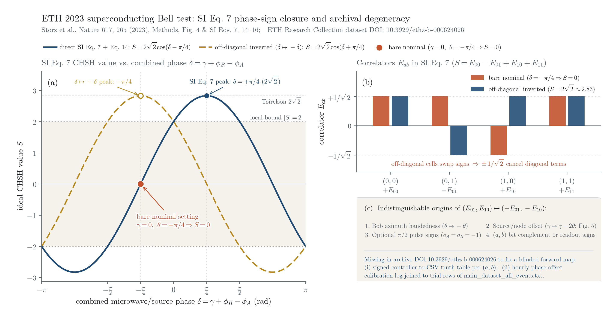

# ETH 2023 Superconducting Loophole-Free Bell Test: Phase-Sign Bridge Check

Standalone, zero-dependency Python 3 standard-library check of the pulse-to-record phase and sign conventions documented in:

- S. Storz *et al.*, "Loophole-free Bell inequality violation with superconducting circuits," *Nature* **617**, 265-270 (2023), DOI: `10.1038/s41586-023-05885-0` (Methods "Optimizing the measurement basis", Fig. 4; Supplement Section I Eq. 7, Section II, Table SIV, and Section IX Eqs. 14-16).
- S. Storz, *ETH Research Collection* dataset (2023-07-26), DOI: `10.3929/ethz-b-000624026` (`ETH_repo_upload/main_dataset_all_events.txt`, SHA-256 `5881b901b0d4a148104b14eadabe80c4f742026e2a120397af23013c2113a848`).



## Quick Start

From the repository root (or directly inside this folder; `run_bridge_check.py` uses only the Python 3 standard library and loads zero experimental outcome counts):

```bash
# Run all 12 algebraic unit tests across 64 sign/handedness combinations (<0.1s):
python3 scripts/physics/bell-ethz-2023/run_bridge_check.py

# Regenerate the summary figure above (requires matplotlib):
python3 scripts/physics/bell-ethz-2023/plot_bridge.py
```

## Summary of Findings

1. **Pre-unblinding closure check on SI Eq. 7 (`S = E_00 - E_01 + E_10 + E_11`)**:
   - Using the SI Eq. 14 prepared-state ordering `(|eg> + exp(-i*gamma)|ge>) / sqrt(2)`, microwave phase convention `phi = 0 -> X`, `phi = pi/2 -> Y`, fixed-then-optional quarter-turn rotations (`0 = block`, `1 = pass`), and `|g> -> +1`, `|e> -> -1` (Table SIV), the four correlators for `delta = gamma + phi_B - phi_A` evaluate to `(E_00, E_01, E_10, E_11) = (cos(delta), -sin(delta), +sin(delta), cos(delta))`, giving `S(delta) = 2*sqrt(2)*cos(delta - pi/4)`.
   - Evaluated directly at `gamma = 0` and the bare nominal setting `theta = -pi/4`, this yields `E = (+1, +1, -1, +1)/sqrt(2)` and **`S_ideal = 0`** (exact off-diagonal cancellation). Scalar visibility `v` and independent asymmetric readout fidelities `(F_0, F_1)` yield `S_obs = 2*(F_0A - F_1A)*(F_0B - F_1B) + kappa_A*kappa_B*v*S_ideal` and cannot repair `S_ideal = 0`.

2. **Observational degeneracy & archival metadata needed for a blinded forward map**:
   - Inverting the two off-diagonal correlators `(E_01, E_10) -> (-E_01, -E_10)` (`S_ideal = 2*sqrt(2)`) produces identical 16-cell joint probability tables `P(x, y | a, b)` across five distinct conventions: (1) Bob pulse-azimuth handedness `theta -> -theta`, (2) inter-node preparation phase offset `gamma -> gamma - 2*theta` (cf. Fig. 5 ~160 deg offset recalibrated roughly hourly), (3) reversing both stations' optional-pulse signs `o_A = o_B = -1`, (4) complementing raw setting bits `(a, b)`, or (5) setting-conditioned readout flips.
   - Closing an unconditioned forward hardware-to-CSV prediction from `DOI: 10.3929/ethz-b-000624026` prior to inspecting trial outcomes requires: (i) the signed controller-to-CSV truth table per `(a, b)` setting, and (ii) the hourly phase-offset calibration log joined to the trial rows of `main_dataset_all_events.txt`.

## Related Repository Records

- Bridge derivation & calibration audit notes: [`evidence/first-release/h/physics/stage10/independent-bell/bridge-review/`](../../../evidence/first-release/h/physics/stage10/independent-bell/bridge-review/README.md)
- Frozen dataset custody metadata: [`evidence/first-release/h/physics/stage10/independent-bell/custody/r0002-storz2023-metadata.json`](../../../evidence/first-release/h/physics/stage10/independent-bell/custody/r0002-storz2023-metadata.json)
