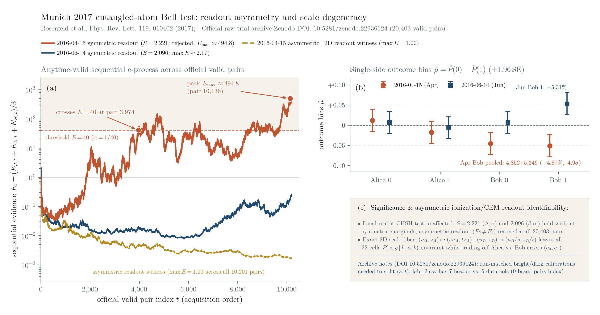

# Munich 2017 Entangled-Atom Loophole-Free Bell Test: Readout Asymmetry & Scale Degeneracy Audit

Standalone, zero-dependency Python 3 standard-library audit of symmetric vs. asymmetric atomic spin readout and CSV schema structure in the official Munich Bell test archives:

- W. Rosenfeld, D. Burchardt, R. Garthoff, K. Redeker, N. Ortegel, M. Rau, and H. Weinfurter, "Event-Ready Bell Test Using Entangled Atoms Simultaneously Closing Detection and Locality Loopholes," *Phys. Rev. Lett.* **119**, 010402 (2017), DOI: `10.1103/PhysRevLett.119.010402`.
- W. Rosenfeld *et al.*, *Experimental data and archived website material for "Event-Ready Bell Test Using Entangled Atoms Simultaneously Closing Detection and Locality Loopholes"*, Zenodo (2026), DOI: `10.5281/zenodo.22936124`:
  - `Bell_2016-04-15.zip` (`369,992` bytes, SHA-256 `da9e1125034e5e61a177ae1796f6362ab312bbfbc5947aeec0b09a85e67b8656`, `10,201` valid pairs, `S = 2.221`).
  - `Bell_2016-06-14.zip` (`391,935` bytes, SHA-256 `b24fb1693dfd14bc4d2b05df6bb23a53fc1e77b3d932c67668c2b7b9515bd84a`, `10,202` valid pairs, `S = 2.096`).



## Quick Start

From the repository root (uses only the Python 3 standard library; automatically fetches and SHA-256-verifies the `761 KB` Zenodo archives if `--archive-dir` is omitted):

```bash
# Run all algebraic/martingale unit tests only (<0.1s, offline):
python3 scripts/physics/bell-munich-2017/run_munich_check.py --tests-only

# Run unit tests + full 20,403-pair sequential audit against Zenodo 22936124:
python3 scripts/physics/bell-munich-2017/run_munich_check.py

# Regenerate the summary figure above (requires matplotlib):
python3 scripts/physics/bell-munich-2017/plot_munich.py
```

## Summary of Findings

1. **Angle- and encoding-invariant rejection of symmetric projective readout on `2016-04-15`**:
   - For either heralded state (`Psi+` or `Psi-`) with optional depolarizing noise and arbitrary equatorial/XZ readout angles, symmetric binary readout channels (`F_0 = F_1`) satisfy `P(0, 0 | h, a, b) = P(1, 1 | h, a, b)`, `P(0, 1 | h, a, b) = P(1, 0 | h, a, b)`, and single-side marginals `1/2 : 1/2`, invariant under all `2^5 = 32` binary label maps.
   - Scored sequentially in original acquisition order via the exact rational mixture e-process `E_t = (E_{J,t} + E_{A,t} + E_{B,t}) / 3` (`alpha = 1/40` per run, threshold `40`; familywise `alpha = 1/20`), the primary `2016-04-15` run (`10,201` pairs, `S = 2.2210`) **crosses `E >= 40` at pair `3,974` and peaks at `E_max = 494.85` (pair `10,136`)**, driven by Bob's ~4.9% outcome skew (`4,852 : 5,349`, `p = 8.7e-7`, `4.92 sigma`) across both settings (`Bob 0`: `2,448 : 2,684`; `Bob 1`: `2,404 : 2,665`), whereas Alice is balanced (`5,085 : 5,116`). The `2016-06-14` run (`10,202` pairs, `S = 2.0958`) stays below `E_max = 13/6 ≈ 2.17`, with Bob's bias reversing sign (`5,254 : 4,948`, concentrated in `Bob 1`: `2,707 : 2,434`, `+5.31%`).

2. **Asymmetric ionization/CEM readout resolution & 2D inverse-scale non-identifiability**:
   - Allowing local asymmetric binary readout channels `(mu, u, z)` per station/setting (physically expected for state-selective photoionization + CEM detection where incomplete ionization, spontaneous decay to `F = 1`, and dark counts affect `up` and `down` unequally) reconciles all `20,403` pairs across both runs (`April max E = 1.00`, `June max E <= 1.34`).
   - Within this model, rescaling `(u_A, z_A) -> (s * u_A, t * z_A)` and `(u_B, z_B) -> (u_B / s, z_B / t)` preserves all 32 conditional probabilities `P(x, y | h, a, b)` identically while trading off Alice's vs. Bob's canonical assignment error rates `(e_0, e_1)`. Black-box local-realist CHSH violations (`S = 2.221` and `2.096 > 2`) are unaffected, whereas uniquely separating station readout fidelities requires run-matched single-atom bright/dark calibration logs.

3. **Archival CSV schema notes on `DOI: 10.5281/zenodo.22936124`**:
   - `Bell_2016-04-15_9_lab_2.csv` and `Bell_2016-06-14_16_lab_2.csv` carry a trailing semicolon in the header (`7` header fields vs. `6` fields in data rows); `*_lab_1/2.csv` use `;` delimiters while `*_pairs.csv` uses `TAB`; and `line in lab 1/2 file` in `*_pairs.csv` is `0`-indexed after the header line (`row = index + 1`).
   - `Readme.txt` does not include an explicit token dictionary mapping raw `setting in {0, 1}` and `result in {0, 1}` to physical angles (`alpha, alpha', beta, beta'`) and click/no-click (`up/down`), or documenting the `excluded from evaluation` tokens across the `867` unpaired local attempts (`64` in April, `803` in June).
