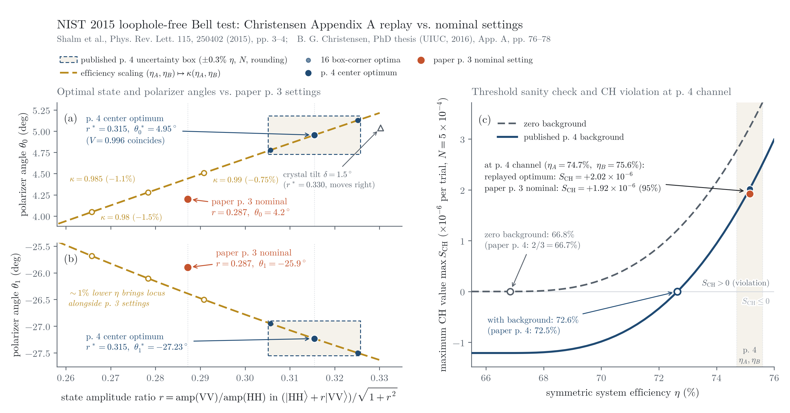

# NIST 2015 Loophole-Free Bell Test: Nominal Apparatus Optimum Replay (`r0003`)

Standalone, zero-dependency Python 3 standard-library reproduction of the CH-inequality parameter optimization reported in:

- L. K. Shalm *et al.*, *Phys. Rev. Lett.* **115**, 250402 (2015), DOI: `10.1103/PhysRevLett.115.250402` (pp. 3-4 nominal settings and global channel parameters).
- B. G. Christensen, PhD thesis (UIUC, 2016), Appendix A (pp. 76-78) and Section 4.6.2 (pp. 46-47).



## Quick Start

From the repository root (works from either `git clone` or a GitHub `.zip` archive download; `run_r0003.py` uses only the Python 3 standard library):

```bash
# Fast sanity & threshold check (~5 seconds):
python3 scripts/physics/bell-nist/nist-real/run_r0003.py --tests-only

# Full 16-corner box optimization + independent density-matrix verification (~3 minutes):
python3 scripts/physics/bell-nist/nist-real/run_r0003.py

# Regenerate the summary figure above (requires matplotlib):
python3 scripts/physics/bell-nist/nist-real/plot_r0003.py
```

`run_r0003.py` verifies all SHA-256 digests of the pinned scripts and input extracts, stages them in an ephemeral temporary directory without modifying any tracked file, runs both independent implementations, and checks exact agreement with the archived receipt.

## Summary of Results (`r0003`, published +/- 0.3% efficiency half-width)

1. **Threshold validation (p. 4 check)**:
   - Zero background threshold: model `0.66845` vs. paper `2/3` (`0.66667`).
   - Published background threshold (`b_A = 8.9e-7`, `b_B = 3.2e-7`, `N = 5e-4`): model `0.72643` vs. paper `72.5%`.

2. **16-corner channel uncertainty box (`eta_A = 0.747 +/- 0.003`, `eta_B = 0.756 +/- 0.003`, `N in [4e-4, 6e-4]`, `V in [0.996, 0.999]`)**:
   - Center optimum: `r* = 0.315464`, `theta_0* = 4.9547 deg`, `theta_1* = -27.2329 deg` (`S_CH* = 2.017e-6`).
   - Full box band (widened by `+/- 0.0005` in `r` and `+/- 0.05 deg` in angle for published rounding):
     - `r` in `[0.30516, 0.32571]`
     - `theta_0` in `[4.7276 deg, 5.1796 deg]`
     - `theta_1` in `[-27.5528 deg, -26.9009 deg]`
   - Documented nominal settings (`0.961|HH> + 0.276|VV>` -> `r = 0.287201`, `theta_0 = 4.2 deg`, `theta_1 = -25.9 deg`) fall outside this band on all coordinates (corresponding to rescaling `eta_A, eta_B` by `kappa ~ 0.988`, i.e. ~0.9 percentage points lower efficiency).

3. **Dual-implementation cross-check**:
   - Primary (`replay.py`): Born-amplitude formula + 18-neighbour pattern search.
   - Independent (`independent_replay.py`, zero shared code): 4x4 density matrix with explicit partial trace + golden-section coordinate ascent.
   - Worst-case discrepancy across all 17 box points: `7.42e-7` (within tolerance `1e-5` in `r` and `1e-3 deg` in angle).

## Pinned Files and SHA-256 Digests

| Role | Repository Path | SHA-256 |
| --- | --- | --- |
| Criterion (`r0003`) | `evidence/first-release/ab/physics/stage10/independent-bell/nist-real/nominal-replay/criterion-r0003.md` | `2dd6d3e511da35415637edda8a164b1569c055a16ec7d25b99f262c5d86412d6` |
| Documented apparatus | `evidence/physics/bell-nist/nist-real/instrument.json` | `4becca05d3a92bdd37d6218d83db64d80df5b4c605766056285d2bb32c0519c4` |
| Thesis Appendix A extract | `docs/source/physics/bell-nist/nist-real/nominal-replay/christensen-appendix-a.txt` | `75dd07c2af8d81e42c410f04c8b8f32b7a884d4c23e8f505f377c44af70fdd5a` |
| Paper p. 4 channel inputs | `docs/source/physics/bell-nist/nist-real/nominal-replay/shalm2015-channel-inputs.txt` | `17c5bc32515536634c451bf761f748ccd2e6c6002fa3949b58524e4cc1aeb3eb` |
| Primary replay (`r0003`) | `scripts/first-release/ab/physics/stage10/independent-bell/nist-real/nominal-replay/replay.py` | `264bb4a516e6fadf2cf39114ff912cae43361de002ae3af62d4d93121ef3eac7` |
| Independent check (`r0003`) | `scripts/first-release/ab/physics/stage10/independent-bell/nist-real/nominal-replay/independent_replay.py` | `05a597026b461f8c6525a082393d3d286a55dbcf3745c4d10144f1aeead0f21c` |
| Unit & sanity tests | `scripts/first-release/ab/physics/stage10/independent-bell/nist-real/nominal-replay/tests.py` | `30802cde28fb7bfcd1770a1abd90a5268d7feaba204e0b4ac9bbda0324dcc349` |
| Archived primary receipt | `evidence/first-release/acceptance/scientific-20261005/nist-nominal-replay/replay-r0003.json` | Verified field-for-field by `run_r0003.py` |
